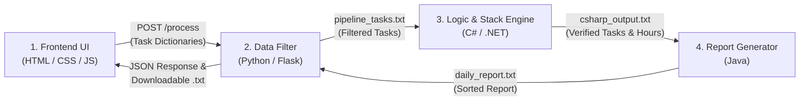

# Kanban Board & Productivity Dashboard

A multi-language Kanban task manager and focus companion that combines a **Glassmorphism web interface** (`JavaScript`, `HTML5`, `CSS3`) with a **three-stage backend processing pipeline** (`Python`, `C#`, and `Java`).

Designed as an all-in-one daily workbench, the application lets you organize tasks across stages, track remaining workload hours in real time, run an unpausable Pomodoro focus cycle, undo accidental task deletions using a Last-In-First-Out (LIFO) stack, and export an alphabetically sorted daily productivity report.


---

## Table of Contents

1. [Key Features](#key-features)
2. [System Architecture & Pipeline](#system-architecture--pipeline)
3. [Component Breakdown](#component-breakdown)
4. [API Endpoints](#api-endpoints)
5. [Project Structure](#project-structure)
6. [Getting Started](#getting-started)
7. [Sample Daily Report Output](#sample-daily-report-output)

---

## Key Features

### 1. Interactive Kanban Board
- **Dynamic Task Creation**: Add tasks with a description, estimated workload hours (`Est. Hours`), and an initial stage (`To-Do`, `In Progress`, or `Done`) via a custom-built dropdown menu.
- **Stage Transitions**: Move tasks smoothly between **To-Do**, **In Progress**, and **Done** using each card's **`←` / `→`** arrow buttons or via **HTML5 Drag-and-Drop**.
- **Task Removal & LIFO Undo**: Delete tasks from any box using the **`×`** button. Deleted tasks are pushed onto a **Last-In-First-Out (LIFO) Undo Stack**, allowing you to click **Undo Delete** to restore the most recently removed task back to its original stage.
- **Live Workload Metrics**: The header displays real-time counters for **Pending** tasks (`To-Do` + `In Progress`), **Completed** tasks (`Done`), and **Est. Workload** (total unfinished hours remaining across `To-Do` and `In Progress`, which automatically decreases as tasks move to `Done`).
- **Local Persistence**: Board state is automatically synced to `localStorage` so your tasks persist across browser refreshes.

### 2. Unpausable Pomodoro Focus Timer
- **Automated 4-Round Cycle**: Clicking **Start** initiates a structured Pomodoro sequence:
  - **4x Focus & Short Break Rounds**: `25:00` Focus session followed immediately by a `05:00` Short Break, repeated for 4 rounds.
  - **Long Break**: After completing the 4th Focus session, the timer transitions automatically into a `15:00` Long Break.
- **Strict Unpausable Mode**: Once started, the timer button locks (`Running...`) and cannot be paused until the cycle completes, encouraging deep, distraction-free work sessions.
- **Visual & Audio Feedback**: Includes a live countdown readout, a progress bar, 4 round-indicator dots, a subtle Web Audio API completion chime between phases, and an interactive **`(i)` Info Modal** detailing the timer rules.

### 3. Glassmorphism UI & Custom Controls
- **Frosted Glass Surfaces**: Built with multi-layered `backdrop-filter: blur()`, translucent `rgba()` surfaces, specular borders, and a soft pastel mesh backdrop.
- **Typography**: Pairs geometric **`Outfit`** headings and tabular numerals (`font-variant-numeric: tabular-nums`) with **`Inter`** body text for clean legibility.
- **Custom Dropdown & Modal**: Replaces native OS select popups with a custom styled menu and includes a two-column info modal dialog.

---

## System Architecture & Pipeline

When you click **Generate Daily Report** (or delete/undo tasks), data flows through four connected language modules:



---

## Component Breakdown

### 1. The Task Board Frontend (`index.html`, `style.css`, `script.js`)
- **Dynamic DOM Generation**: Reads form inputs (`#taskInput`, `#hoursInput`, `#statusSelect`) and uses `document.createElement("li")` and `appendChild()` to mount task cards into `#todoList`, `#progressList`, or `#doneList`.
- **Visual Completion State**: Automatically updates `li.style.backgroundColor` and applies strikethrough styling when tasks enter the **Done** stage.
- **Pomodoro Interval Engine**: Uses `setInterval()` to decrement the timer every second (`1000ms`), updating `#timerDisplay` and `#timerProgressBar` until reaching `00:00`, where it calls `clearInterval()` and transitions to the next phase in `POMODORO_SEQUENCE`.

### 2. The Data Filter (`main.py` — Python)
- **Task Dictionaries**: Represents each task as a Python dictionary containing its name, status, and estimated hours:
  ```python
  {"name": "Draft Q4 product roadmap", "status": "Done", "hours": 1.5}
  ```
- **Functional Filtering**: Uses Python's `filter()` combined with `lambda` functions to separate completed tasks from pending tasks:
  ```python
  completed_tasks = list(filter(lambda task: task["status"].lower() == "done", task_dicts))
  pending_tasks = list(filter(lambda task: task["status"].lower() != "done", task_dicts))
  ```
- **Fault-Tolerant Error Handling**: Wraps payload normalization and filtering in `try` and `except (KeyError, TypeError)` blocks so malformed task objects (e.g., a dictionary missing a `"status"` or `"name"` key) are safely skipped without crashing the server.

### 3. The Logic & Workflow Engine (`Program.cs` — C#)
- **LIFO Undo Stack (`Stack<string>`)**: Implements a Last-In-First-Out undo system using C#'s generic `Stack<string>`. Deleting a task calls `.Push()` to record it onto the stack (`undo_stack.txt`), and clicking **Undo Delete** calls `.Pop()` to return the most recent task back to the active board.
- **Operator Overloading (`TaskStats`)**: Defines a custom `TaskStats` struct with an overloaded `+` operator (`public static TaskStats operator +(TaskStats a, TaskStats b)`) to cleanly sum individual task objects and calculate both completed work hours and total daily workload hours:
  ```csharp
  public static TaskStats operator +(TaskStats a, TaskStats b)
  {
      return new TaskStats("Combined Workload", a.Hours + b.Hours);
  }
  ```

### 4. The Daily Report Generator (`report.java` — Java)
- **Alphabetical Roster Sorting**: Reads the processed task data from `csharp_output.txt` into an `ArrayList<String>` and organizes completed tasks alphabetically using `Collections.sort()`.
- **Formatted File Output**: Instantiates a `File` object and uses `java.util.Formatter` to write the sorted task roster, task counts, and calculated workload hours into `daily_report.txt`, calling `.close()` to permanently save the log.

---

## API Endpoints

The Flask server in `main.py` exposes the following endpoints:

| Method | Endpoint | Description |
| :--- | :--- | :--- |
| `GET` | `/` | Serves the main `index.html` Kanban dashboard. |
| `POST` | `/process` | Filters tasks via Python (`filter`/`lambda`), runs the C# `TaskStats` & `Stack` engine, triggers the Java `Formatter` report generator, and returns the generated report. |
| `POST` | `/undo/push` | Invokes the C# engine (`dotnet run -- push`) to push a deleted task onto the persistent LIFO `Stack<string>`. |
| `POST` | `/undo/pop` | Invokes the C# engine (`dotnet run -- pop`) to pop and return the most recently deleted task from the LIFO `Stack<string>`. |
| `GET` | `/report` | Returns the latest generated `daily_report.txt` content. |

---

## Project Structure

```text
kanban-board/
├── assets/
│   └── preview.png          # Application UI screenshot
├── index.html               # Main dashboard layout, custom dropdown, and Pomodoro info modal
├── style.css                # Glassmorphism styling, animations, and responsive grid layout
├── script.js                # Frontend state, DOM manipulation, Pomodoro clock, and API calls
├── main.py                  # Python Flask server, dictionary normalization, and lambda filtering
├── Program.cs               # C# LIFO Stack<string> undo engine and TaskStats operator+ math
├── KanbanBoard.csproj       # .NET project configuration file
├── report.java              # Java ArrayList sorting and Formatter report generator
├── pipeline_tasks.txt       # Intermediate filtered task data passed from Python to C#
├── csharp_output.txt        # Intermediate verified workload data passed from C# to Java
├── undo_stack.txt           # Persistent LIFO undo stack storage managed by C#
├── daily_report.txt         # Final formatted productivity report generated by Java
└── README.md                # Project documentation
```

---

## Getting Started

### Prerequisites

Make sure the following runtimes are installed and available in your system `PATH`:

1. **Python 3.7+** with `Flask`:
   ```bash
   pip install flask
   ```
2. **.NET SDK** (C# compiler & runtime):
   ```bash
   dotnet --version
   ```
3. **Java JDK 11+** (supports single-file source execution `java report.java`):
   ```bash
   java --version
   ```

### Installation & Running Locally

1. **Clone the repository**:
   ```bash
   git clone https://github.com/michaelsalusu06/kanban-board.git
   cd kanban-board
   ```

2. **Pre-build the C# project (optional, speeds up first run)**:
   ```bash
   dotnet build
   ```

3. **Start the Python Flask server**:
   ```bash
   python main.py
   ```

4. **Open the application in your browser**:
   Navigate to [http://127.0.0.1:5000](http://127.0.0.1:5000).

> **Note**: You can also open `index.html` directly in any browser for standalone frontend usage — task creation, stage movement, LIFO undo, the Pomodoro timer, and client-side report downloading all work out of the box.

---

## Sample Daily Report Output

Clicking **Generate Daily Report** and then **Download** produces a `daily_report.txt` file formatted like this:

```text
====================================================
          DAILY PRODUCTIVITY & WORKLOAD LOG         
====================================================

COMPLETED TASKS (Alphabetical Roster):
----------------------------------------------------
  1. Draft Q4 product roadmap (1.5h)
  2. Review open pull requests (2.0h)

----------------------------------------------------
WORKLOAD SUMMARY
----------------------------------------------------
  Completed Tasks        : 2
  Pending Tasks          : 2
  Completed Work Hours   : 3.5 hrs
  Total Daily Workload   : 7.0 hrs
====================================================
```
