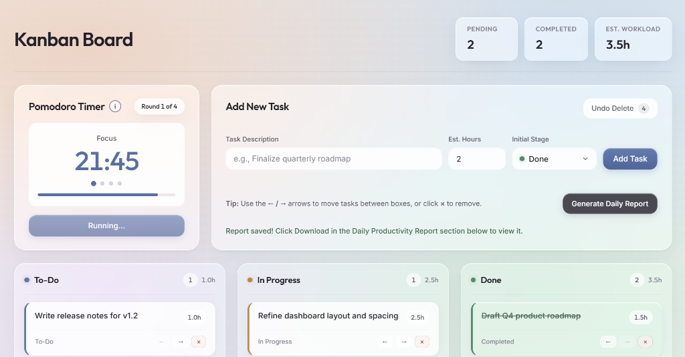

# Kanban Board & Productivity Dashboard

A multi-language Kanban-style task manager and focus tracker featuring a glassmorphic web interface, an unpausable Pomodoro focus clock, a functional data filter, a LIFO undo & workload calculation engine, and an automated daily productivity report generator.



---

## Features

- **Glassmorphic Kanban Board (`To-Do`, `In Progress`, `Done`)**
  - Dynamically create tasks with estimated hours and initial stage selection via a custom glassmorphic dropdown.
  - Move tasks across columns using the **`←` / `→`** controls or drag-and-drop.
  - Remove tasks from any column with **`×`** and restore accidentally deleted tasks in Last-In-First-Out (LIFO) order using **Undo Delete**.
  - Live header metrics tracking **Pending** tasks, **Completed** tasks, and remaining **Est. Workload** hours.
- **Unpausable Pomodoro Timer**
  - Structured **4-round cycle**: 25-minute Focus session followed by a 5-minute Short Break (repeated 4 times), concluding with a 15-minute Long Break.
  - Once started, the timer runs continuously through the cycle without pausing to enforce deep, uninterrupted focus.
  - Includes an interactive info modal (`i`) detailing the timer structure and rules.
- **Automated Daily Report Export (`daily_report.txt`)**
  - Generates and downloads a formatted daily summary containing an alphabetically sorted roster of completed tasks and calculated workload metrics.

---

## Architecture

1. **Frontend (`index.html`, `style.css`, `script.js`)**
   - Built with vanilla HTML5, CSS3 (Glassmorphism UI with `Outfit` and `Inter` typography), and JavaScript (`document.createElement`, `appendChild`, `setInterval` / `clearInterval`).
2. **Data Filter (`main.py` — Python & Flask)**
   - Normalizes task dictionaries (`{"name": ..., "status": ..., "hours": ...}`) and separates completed vs. pending work using functional programming (`filter()` and `lambda` functions) wrapped in `try` / `except (KeyError, TypeError)` error handling.
3. **Logic & Workflow Engine (`Program.cs` — C# / .NET)**
   - Manages the LIFO undo history using a generic `Stack<string>` (`Push()` and `Pop()`) and computes workload totals using custom struct operator overloading (`public static TaskStats operator +`).
4. **Daily Report Generator (`report.java` — Java)**
   - Reads verified task records into an `ArrayList<String>`, sorts them alphabetically via `Collections.sort()`, and writes `daily_report.txt` using `File` and `Formatter`.

---

## Getting Started

### Prerequisites

- **Python 3.x** (with `flask` installed: `pip install flask`)
- **.NET SDK** (`dotnet`)
- **Java JDK** (`java`)

### Running the Application

1. Clone the repository:
   ```bash
   git clone https://github.com/michaelsalusu06/kanban-board.git
   cd kanban-board
   ```

2. Start the server:
   ```bash
   python main.py
   ```

3. Open `http://127.0.0.1:5000` in your browser.
